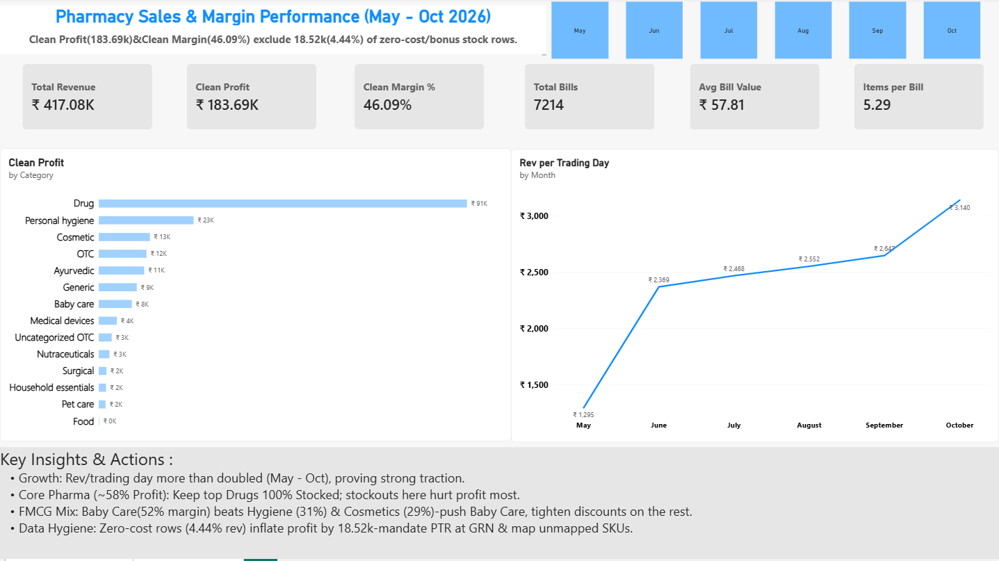
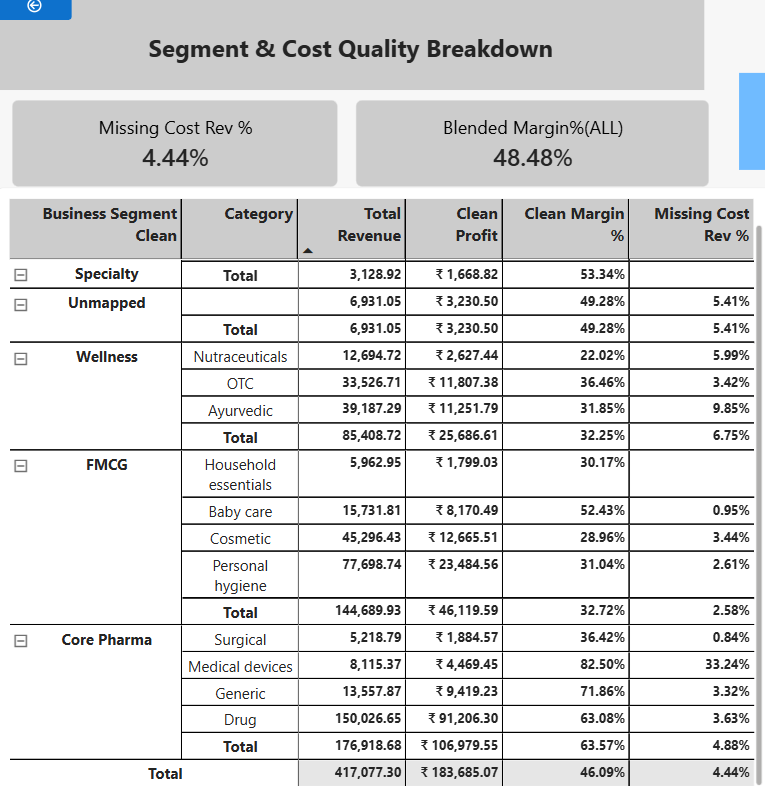

# Retail Pharmacy Sales & Margin Analytics (eVitalRx POS)

## Project Overview
End-to-end analysis of 6 months of real retail pharmacy POS data (*7,214 bills, *₹417.08K revenue) to identify true profit drivers, fix partial-month reporting distortions, and audit missing-cost POS anomalies.

*Tech Stack:* Excel (Power Query) • MySQL • Power BI (DAX)

---

## Dashboard Preview

### Page 1: Executive Summary

### Page 2: Segment & Cost Quality Breakdown

---

## Key Findings & Business Actions
* *Exposing Fake Margins:* Zero-cost/bonus stock rows (*4.44% of revenue, ₹18.52K) inflated raw blended margin to **48.48%**. Filtering for verified costs (PTR > 0) revealed a true **Clean Margin of 46.09%* (*₹183.69K Clean Profit*).
* *Operational Growth:* Switching from raw monthly totals to *Revenue per Trading Day* removed incomplete-month drop-offs and showed daily revenue more than doubled from May to October.
* *Core Pharma (~58% of Clean Profit):* Prioritize 100% stock availability on top-moving drugs; stockouts here hurt net profit most.
* *FMCG Margin Mix:* Baby Care earns *~52% margin* vs. Personal Hygiene (*31%) and Cosmetics (29%*). Push Baby Care visibility and tighten ad-hoc discounts on Hygiene and Cosmetics.
* *POS Data Hygiene:* Missing costs are concentrated in Medical Devices (*~33%) and Ayurvedic (~10%*). Mandate PTR entry at goods-receipt (GRN) starting with these two categories.

---

## Repository Contents
* pharmacy_analysis.sql — Data exploration, quality audit, and reconciled KPI queries.
* Pharmacy_Sales_Margin_Report.pbix — Interactive 2-page Power BI report.
